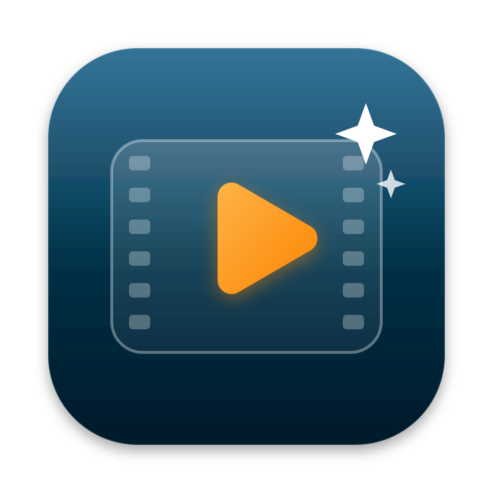
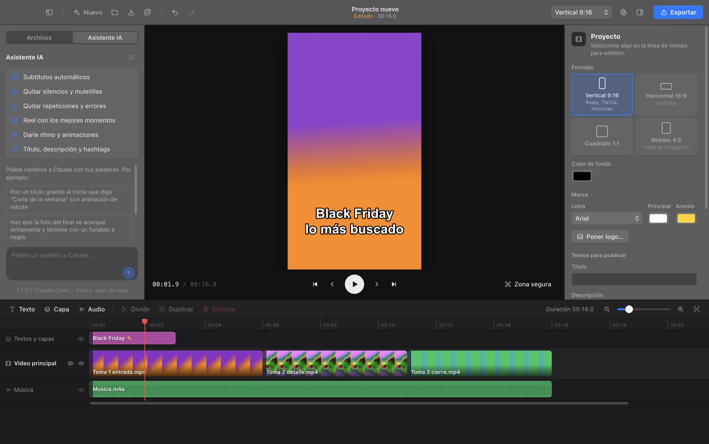
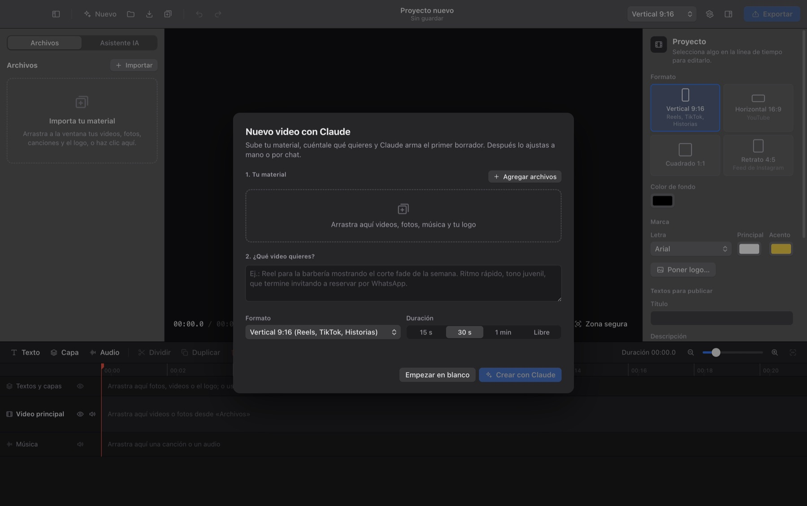
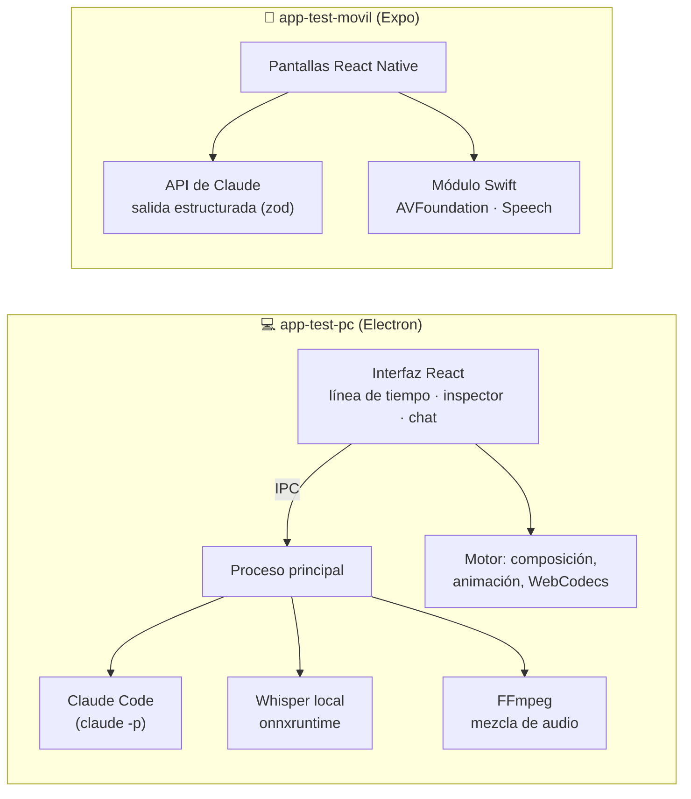

<div align="center">



# Editor de Video con IA

**Subes tus clips, le dices a Claude qué video quieres y te arma el primer borrador: cortes, textos animados, subtítulos y el texto para publicar.**
Después lo ajustas a mano o por chat, y exportas.


</div>

<p align="center">
  
</p>

Lo hice para el equipo de una agencia de marketing que publica Reels y TikToks todos los días: la idea es que el primer corte salga en minutos y que el tiempo se use en pulir, no en armar desde cero. Son **dos apps** en un mismo repositorio:

| | 💻 Computador (`app-test-pc`) | 📱 iPhone (`app-test-movil`) |
|---|---|---|
| Para qué | Edición completa | Edición rápida desde el teléfono |
| Tecnología | Electron + React + TypeScript | Expo / React Native + módulo nativo en Swift |
| IA | Claude Code con la sesión del usuario (sin clave de API) | API de Claude con la clave del usuario, guardada en el llavero del iPhone |
| Transcripción | Whisper local (onnxruntime) | Speech de Apple, en el dispositivo |
| Exportación | WebCodecs + FFmpeg | AVFoundation |
| Plataformas | macOS (Apple Silicon) y Windows | iOS |

## ✨ Qué hace

**Asistente de inicio.** Arrastras videos, fotos, música y el logo; escribes qué video quieres (“Reel para la barbería mostrando el corte de la semana, ritmo rápido, que termine invitando a reservar por WhatsApp”) y eliges formato y duración. Claude mira fotogramas de cada clip, lee la transcripción y arma el montaje.

<p align="center"></p>

**Edición con IA por chat o con un toque:**
- Subtítulos automáticos
- Quitar silencios y muletillas, repeticiones y errores
- Reel con los mejores momentos
- Ritmo y animaciones
- Título, descripción y hashtags para publicar

**Edición a mano, al estilo Final Cut:**
- Línea de tiempo con varias pistas (textos y capas, video, música), zoom y alto ajustable
- Keyframes y animaciones de entrada y salida
- Textos con estilos (título, subtítulo, etiqueta, impacto), borde, sombra y fondo
- Marca del proyecto: letra, colores y logo
- Formatos 9:16, 16:9, 1:1 y 4:5, con zona segura para Reels y TikTok
- Deshacer y rehacer, menús contextuales nativos y atajos de teclado (⌘/)

**En el iPhone:**
- Línea de tiempo tipo iMovie, con el cursor fijo y la tira de fotogramas que se desliza
- Pestañas de IA, Cortes, Textos y Más
- Exporta el mp4 en el teléfono y lo guarda en Fotos

## 🏗️ Cómo está armado



- **La IA devuelve órdenes de edición, no video.** Claude responde con operaciones tipadas (`src/shared/ops.ts` en el computador, el montaje completo validado con zod en el iPhone). La app las valida y corrige antes de aplicarlas, así un error del modelo nunca rompe el proyecto.
- **El código puro tiene pruebas:** el modelo del proyecto, los cortes de silencio, las operaciones de la línea de tiempo y el montaje (31 pruebas entre las dos apps).
- **Vista previa = exportación.** Las medidas de los textos se comparten entre TypeScript y Swift para que lo que ves sea lo que se exporta.
- **Seguridad:** en Windows solo se lanza `claude.exe` sin shell (sin inyección de órdenes) y se rechazan rutas de red al abrir archivos (sin fugas de credenciales NTLM).

## 🚀 Probarlo

### Computador

Necesitas Node 24+ y, para la IA, [Claude Code](https://claude.com/claude-code) con tu sesión iniciada.

```bash
cd app-test-pc
npm install
npm run dev                    # abre la app
node --test "tests/*.test.ts"  # pruebas
npm run dist:mac               # genera el .dmg
```

Los instaladores de Mac (`.dmg`) y Windows (`.exe`) también salen de GitHub Actions en cada push a `master` (**Actions → Instaladores → Artifacts**). Todavía no están firmados: en Mac hay que abrirlos con clic derecho → Abrir.

### iPhone

```bash
cd app-test-movil
npm install
npm test && npm run typecheck
npm run go        # prueba rápida en Expo Go (sin exportar ni transcribir)
```

La app completa se compila con EAS (`npm run build:prueba`) porque incluye un módulo nativo. La clave de Claude se escribe en **Ajustes** dentro de la app.

## 🔐 Privacidad

- En el computador, los archivos de video nunca se suben: Claude Code solo puede leer (sin escribir ni ejecutar nada) la descripción del proyecto, la transcripción, hojas con cuadros pequeños de cada clip y las fotos que agregues.
- En el iPhone se envían a la API de Claude fotos pequeñas de cada clip y la transcripción. La clave se guarda en el llavero del teléfono.
- No hay servidor propio ni analítica.

## 🗺️ Estado

- ✅ Computador: v2 completa y probada en Mac, con rediseño nativo de macOS.
- ✅ iPhone: probada en un iPhone real con una build interna de EAS.
- ⏳ Pendiente: firmar y notarizar el `.dmg`, probar el `.exe` en Windows y distribuir por TestFlight.

## 📄 Licencia

[MIT](./LICENSE) © Alberto José Duque Gámez
